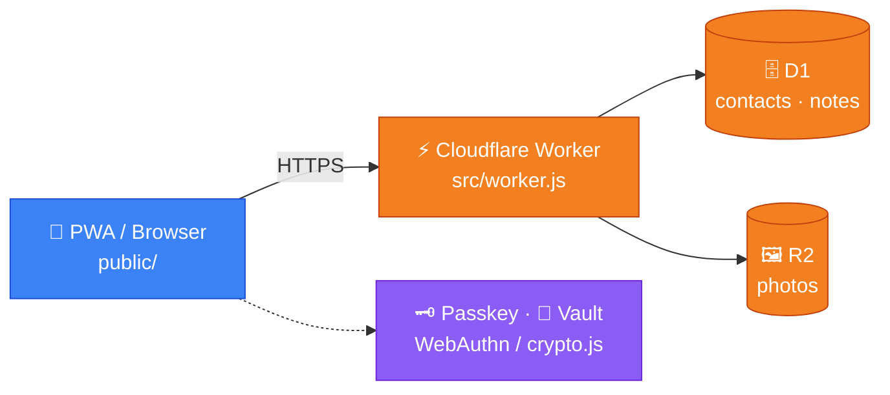

<h1 align="center">📒 Kontakt-Notizbuch</h1>

<p align="center">
  <b>Open source · Quelloffen · Açık kaynak</b><br>
  <sub>Cloudflare Workers · D1 · R2 · PWA</sub>
</p>

<p align="center">
  <a href="#english">🇬🇧 English</a> &nbsp;·&nbsp;
  <a href="#türkçe">🇹🇷 Türkçe</a> &nbsp;·&nbsp;
  <a href="#deutsch">🇩🇪 Deutsch</a>
</p>

<p align="center">
  <a href="https://kontakt-notizbuch.halilgercek023.workers.dev"></a>
  <a href="https://github.com/Higer23/kontakt-notizbuch/actions/workflows/tests.yml"></a>
  <a href="https://github.com/Higer23/kontakt-notizbuch/actions/workflows/deploy.yml"></a>
  <a href="https://github.com/Higer23/kontakt-notizbuch/stargazers"></a>
  <a href="https://github.com/Higer23/kontakt-notizbuch/issues"></a>
  <a href="LICENSE"></a>
</p>

---

<a id="english"></a>
## 🇬🇧 English

**Kontakt-Notizbuch** is an open-source personal contact notebook built with Cloudflare Workers, D1, and R2. It helps you organize contact details and notes, with access control and sensitive-data handling in focus.

> [!WARNING]
> **Project status:** active development, no independent security certification. Do not use real personal data in tests and review code and configuration before any production use.

<sub>Jump to: <a href="#en-features">Features</a> · <a href="#en-start">Quick start</a> · <a href="#en-contribute">Contributing</a> · <a href="CONTRIBUTING.md">Guide</a> · <a href="SECURITY.md">Security</a></sub>

<a id="en-features"></a>
### ✨ Features
- 🔐 Session-protected sign-in and server-side access checks
- 🔎 Contact search, tags, dates, and age calculation
- 🖼️ Social profile links and photo storage on Cloudflare R2
- ⚡ Cloudflare Worker API with D1 database
- 🗝️ Passkey/WebAuthn and encrypted vault (depending on configuration)
- 🛡️ Security headers and GitHub Actions test/deploy workflows

### 🧰 Tech stack
| | |
|---|---|
| **Frontend** |    |
| **Backend** |    |
| **Tooling** |    |

<details>
<summary><b>🗂️ Project structure</b></summary>

```text
public/    Frontend (app.js, crypto.js, passkey.js, i18n.js, PWA assets)
src/       Cloudflare Worker (worker.js)
schema.sql D1 database schema
tests/     Node.js test scripts
docs/      Setup, security and smoke-test guides
stable/    Frozen snapshots of earlier versions
.github/   Workflows, issue templates, funding
```
</details>

<a id="en-start"></a>
### 🚀 Quick start
**Requirements:** a current supported Node.js release with npm. A Cloudflare account is only needed for Cloudflare resources and remote deployment.

1. Fork the repository and clone your fork, or clone it to explore:
   ```bash
   git clone https://github.com/Higer23/kontakt-notizbuch.git
   cd kontakt-notizbuch
   ```
2. Run the existing tests:
   ```bash
   node tests/crypto.test.mjs
   node tests/csv.test.mjs
   node tests/run-tests.mjs
   ```
3. Authenticate Wrangler with your own Cloudflare account:
   ```bash
   npx wrangler login
   ```
4. Review `wrangler.toml` and configure your own D1/R2 resources and bindings. Do not copy production secrets or modify production resources for experiments.
5. Start the local Worker dev server:
   ```bash
   npx wrangler dev
   ```

> [!CAUTION]
> Applying `schema.sql`, changing D1 bindings, or deploying can affect data and infrastructure. Use isolated development resources and fake data.

<a id="en-contribute"></a>
### 🤝 Contributing
Contributions are welcome! Read the **[Contribution Guide](CONTRIBUTING.md)** first. Browse issues labelled [good first issue](https://github.com/Higer23/kontakt-notizbuch/labels/good%20first%20issue) or [help wanted](https://github.com/Higer23/kontakt-notizbuch/labels/help%20wanted), comment on an issue to coordinate, then open a pull request. Please do not push directly to `main`.

- [Issue #25 — Mobile and desktop browser smoke-test checklist](https://github.com/Higer23/kontakt-notizbuch/issues/25)
- [Issue #26 — Account recovery regression tests](https://github.com/Higer23/kontakt-notizbuch/issues/26)
- [Manual browser smoke-test checklist](docs/manual-smoke-test.md)

> [!IMPORTANT]
> Report potential vulnerabilities via [SECURITY.md](SECURITY.md), not in public issues.

### 🔒 Security and privacy
- Never commit passwords, API tokens, Cloudflare secrets, or real personal data.
- Use synthetic test data only.
- Protect D1/R2 resources and backups; explain the impact of changes that touch stored data.

### 📄 License & 💖 Support
Released under the [MIT License](LICENSE). You can support the project via [Open Collective](https://opencollective.com/kontakt-notizbuch); support does not change the license.

<p align="right"><a href="#top">⬆️ back to top</a></p>

---

<a id="türkçe"></a>
## 🇹🇷 Türkçe

**Kontakt-Notizbuch**, Cloudflare Workers, D1 ve R2 üzerinde geliştirilen açık kaynaklı bir kişisel rehber ve not defteridir. İletişim bilgilerini ve notları düzenlemeye yardım eder; erişim denetimi ve hassas verilerin korunması odak noktasıdır.

> [!WARNING]
> **Proje durumu:** aktif geliştirme aşamasında, bağımsız güvenlik sertifikası yok. Testlerde gerçek kişisel veri kullanmayın; üretimde kullanmadan önce kodu ve yapılandırmayı inceleyin.

<sub>Git: <a href="#tr-ozellikler">Özellikler</a> · <a href="#tr-kurulum">Hızlı kurulum</a> · <a href="#tr-katki">Katkı</a> · <a href="CONTRIBUTING.md#türkçe">Rehber</a> · <a href="SECURITY.md#türkçe">Güvenlik</a></sub>

<a id="tr-ozellikler"></a>
### ✨ Özellikler
- 🔐 Oturum korumalı giriş ve sunucu tarafında erişim denetimi
- 🔎 Kişi arama, etiketler, tarihler ve yaş hesaplama
- 🖼️ Sosyal profil bağlantıları ve Cloudflare R2'de fotoğraf saklama
- ⚡ D1 veritabanlı Cloudflare Worker API'si
- 🗝️ Passkey/WebAuthn ve şifreli kasa (yapılandırmaya bağlı)
- 🛡️ Güvenlik başlıkları ve GitHub Actions test/dağıtım iş akışları

### 🧰 Teknoloji yığını
| | |
|---|---|
| **Ön yüz** |    |
| **Arka uç** |    |
| **Araçlar** |    |

<details>
<summary><b>🗂️ Proje yapısı</b></summary>

```text
public/    Ön yüz (app.js, crypto.js, passkey.js, i18n.js, PWA dosyaları)
src/       Cloudflare Worker (worker.js)
schema.sql D1 veritabanı şeması
tests/     Node.js test betikleri
docs/      Kurulum, güvenlik ve manuel test rehberleri
stable/    Önceki sürümlerin dondurulmuş kopyaları
.github/   İş akışları, issue şablonları, destek bilgisi
```
</details>

<a id="tr-kurulum"></a>
### 🚀 Hızlı kurulum
**Gereksinimler:** npm içeren güncel ve desteklenen bir Node.js sürümü. Cloudflare hesabı yalnızca Cloudflare kaynakları ve uzak dağıtım için gerekir.

1. Depoyu fork edin ve klonlayın, ya da incelemek için doğrudan klonlayın:
   ```bash
   git clone https://github.com/Higer23/kontakt-notizbuch.git
   cd kontakt-notizbuch
   ```
2. Mevcut testleri çalıştırın:
   ```bash
   node tests/crypto.test.mjs
   node tests/csv.test.mjs
   node tests/run-tests.mjs
   ```
3. Wrangler'ı kendi Cloudflare hesabınıza bağlayın:
   ```bash
   npx wrangler login
   ```
4. `wrangler.toml` dosyasını inceleyin ve kendi D1/R2 kaynaklarınızı yapılandırın. Üretim sırlarını kopyalamayın, deneme için üretim kaynaklarını değiştirmeyin.
5. Yerel geliştirme sunucusunu başlatın:
   ```bash
   npx wrangler dev
   ```

> [!CAUTION]
> `schema.sql` uygulamak, D1 bağlantılarını değiştirmek veya dağıtım yapmak verileri ve altyapıyı etkileyebilir. Ayrı geliştirme kaynakları ve sahte veriler kullanın.

<a id="tr-katki"></a>
### 🤝 Katkıda bulunma
Katkılar memnuniyetle karşılanır! Önce **[Katkı Rehberi'ni](CONTRIBUTING.md#türkçe)** okuyun. [good first issue](https://github.com/Higer23/kontakt-notizbuch/labels/good%20first%20issue) ve [help wanted](https://github.com/Higer23/kontakt-notizbuch/labels/help%20wanted) etiketli görevlere göz atın, koordinasyon için issue'ya yorum bırakın, sonra pull request açın. `main` dalına doğrudan push yapmayın.

- [Issue #25 — Mobil ve masaüstü tarayıcı test listesi](https://github.com/Higer23/kontakt-notizbuch/issues/25)
- [Issue #26 — Hesap kurtarma regresyon testleri](https://github.com/Higer23/kontakt-notizbuch/issues/26)
- [Manuel tarayıcı test listesi](docs/manual-smoke-test.md)

> [!IMPORTANT]
> Olası güvenlik açıklarını herkese açık issue yerine [SECURITY.md](SECURITY.md#türkçe) yönergelerine göre bildirin.

### 🔒 Güvenlik ve gizlilik
- Parola, API token'ı, Cloudflare sırrı veya gerçek kişisel veri commit etmeyin.
- Yalnızca sentetik test verileri kullanın.
- D1/R2 kaynaklarını ve yedekleri koruyun; saklanan verilere dokunan değişikliklerin etkisini açıklayın.

### 📄 Lisans ve 💖 destek
Proje [MIT Lisansı](LICENSE) ile sunulur. [Open Collective](https://opencollective.com/kontakt-notizbuch) üzerinden destek olabilirsiniz; destek lisansı değiştirmez.

<p align="right"><a href="#top">⬆️ başa dön</a></p>

---

<a id="deutsch"></a>
## 🇩🇪 Deutsch

**Kontakt-Notizbuch** ist ein quelloffenes persönliches Kontakt- und Notizbuch auf Basis von Cloudflare Workers, D1 und R2. Es hilft, Kontaktdaten und Notizen zu organisieren – mit Fokus auf Zugriffskontrolle und den Schutz sensibler Daten.

> [!WARNING]
> **Projektstatus:** aktive Entwicklung, keine unabhängige Sicherheitszertifizierung. Verwenden Sie in Tests keine echten personenbezogenen Daten und prüfen Sie Code und Konfiguration vor einem produktiven Einsatz.

<sub>Springe zu: <a href="#de-funktionen">Funktionen</a> · <a href="#de-start">Schnellstart</a> · <a href="#de-mitwirken">Mitwirken</a> · <a href="CONTRIBUTING.md#deutsch">Leitfaden</a> · <a href="SECURITY.md#deutsch">Sicherheit</a></sub>

<a id="de-funktionen"></a>
### ✨ Funktionen
- 🔐 Anmeldung mit sitzungsgeschütztem Zugriff und serverseitigen Berechtigungsprüfungen
- 🔎 Kontaktsuche, Tags, Datumsangaben und Altersberechnung
- 🖼️ Links zu sozialen Profilen und Fotospeicherung über Cloudflare R2
- ⚡ Cloudflare-Worker-API mit D1-Datenbank
- 🗝️ Passkey/WebAuthn und verschlüsselter Tresor (abhängig von der Konfiguration)
- 🛡️ Sicherheits-Header sowie Test- und Deployment-Workflows mit GitHub Actions

### 🧰 Technologie-Stack
| | |
|---|---|
| **Frontend** |    |
| **Backend** |    |
| **Werkzeuge** |    |

<details>
<summary><b>🗂️ Projektstruktur</b></summary>

```text
public/    Frontend (app.js, crypto.js, passkey.js, i18n.js, PWA-Dateien)
src/       Cloudflare Worker (worker.js)
schema.sql D1-Datenbankschema
tests/     Node.js-Testskripte
docs/      Anleitungen zu Einrichtung, Sicherheit und Smoke-Tests
stable/    Eingefrorene Stände früherer Versionen
.github/   Workflows, Issue-Vorlagen, Förderinformationen
```
</details>

<a id="de-start"></a>
### 🚀 Schnellstart
**Voraussetzungen:** eine aktuelle unterstützte Node.js-Version mit npm. Ein Cloudflare-Konto ist nur für Cloudflare-Ressourcen und Remote-Deployments nötig.

1. Repository forken und klonen – oder direkt zum Ausprobieren klonen:
   ```bash
   git clone https://github.com/Higer23/kontakt-notizbuch.git
   cd kontakt-notizbuch
   ```
2. Vorhandene Tests ausführen:
   ```bash
   node tests/crypto.test.mjs
   node tests/csv.test.mjs
   node tests/run-tests.mjs
   ```
3. Wrangler mit dem eigenen Cloudflare-Konto verbinden:
   ```bash
   npx wrangler login
   ```
4. `wrangler.toml` prüfen und eigene D1-/R2-Ressourcen und Bindings konfigurieren. Keine Produktionsgeheimnisse übernehmen und keine Produktionsressourcen für Experimente verändern.
5. Lokalen Entwicklungsserver starten:
   ```bash
   npx wrangler dev
   ```

> [!CAUTION]
> Das Anwenden von `schema.sql`, Änderungen an D1-Bindings oder ein Deployment können Daten und Infrastruktur beeinflussen. Verwenden Sie getrennte Entwicklungsressourcen und Testdaten.

<a id="de-mitwirken"></a>
### 🤝 Mitwirken
Beiträge sind willkommen! Lesen Sie zuerst den **[Leitfaden für Beiträge](CONTRIBUTING.md#deutsch)**. Suchen Sie Issues mit den Labels [good first issue](https://github.com/Higer23/kontakt-notizbuch/labels/good%20first%20issue) oder [help wanted](https://github.com/Higer23/kontakt-notizbuch/labels/help%20wanted), kommentieren Sie zur Abstimmung das Issue und reichen Sie dann einen Pull Request ein. Bitte nicht direkt in `main` pushen.

- [Issue #25 — Checkliste für Browser-Tests auf Mobilgeräten und Desktop](https://github.com/Higer23/kontakt-notizbuch/issues/25)
- [Issue #26 — Regressionstests für die Kontowiederherstellung](https://github.com/Higer23/kontakt-notizbuch/issues/26)
- [Checkliste für manuelle Browser-Smoke-Tests](docs/manual-smoke-test.md)

> [!IMPORTANT]
> Melden Sie mögliche Sicherheitslücken gemäß [SECURITY.md](SECURITY.md#deutsch), nicht in öffentlichen Issues.

### 🔒 Sicherheit und Datenschutz
- Committen Sie niemals Passwörter, API-Tokens, Cloudflare-Geheimnisse oder echte personenbezogene Daten.
- Verwenden Sie ausschließlich künstliche Testdaten.
- Schützen Sie D1-/R2-Ressourcen und Backups; erläutern Sie die Auswirkungen von Änderungen an gespeicherten Daten.

### 📄 Lizenz & 💖 Unterstützung
Das Projekt steht unter der [MIT-Lizenz](LICENSE). Unterstützung ist über [Open Collective](https://opencollective.com/kontakt-notizbuch) möglich; sie ändert die Lizenz nicht.

<p align="right"><a href="#top">⬆️ nach oben</a></p>

---

## 📊 Live · Canlı · Live
<sub>Updated automatically from the GitHub API / GitHub API'den otomatik güncellenir / Automatisch über die GitHub-API aktualisiert</sub>

<p align="center">
  <a href="https://github.com/Higer23/kontakt-notizbuch/commits/main"></a>
  <a href="https://github.com/Higer23/kontakt-notizbuch/graphs/commit-activity"></a>
  <a href="https://github.com/Higer23/kontakt-notizbuch"></a>
  <a href="https://github.com/Higer23/kontakt-notizbuch"></a>
  <br>
  <a href="https://github.com/Higer23/kontakt-notizbuch/issues?q=is%3Aissue+is%3Aclosed"></a>
  <a href="https://github.com/Higer23/kontakt-notizbuch/pulls"></a>
  <a href="https://github.com/Higer23/kontakt-notizbuch/network/members"></a>
  <a href="https://github.com/Higer23/kontakt-notizbuch/graphs/contributors"></a>
  <a href="https://opencollective.com/kontakt-notizbuch"></a>
</p>

### 🧭 Architecture · Mimari · Architektur


<p align="center">
  
</p>

<details>
<summary><b>👥 Contributors · Mitwirkende · Katkıda bulunanlar</b> &nbsp;|&nbsp; <b>⭐ Star history</b></summary>

<p align="center">
  <a href="https://github.com/Higer23/kontakt-notizbuch/graphs/contributors"></a>
</p>
<p align="center">
  <a href="https://star-history.com/#Higer23/kontakt-notizbuch&Date"></a>
</p>
</details>

<p align="center"><sub>Made for contributors everywhere · English · Türkçe · Deutsch</sub></p>
